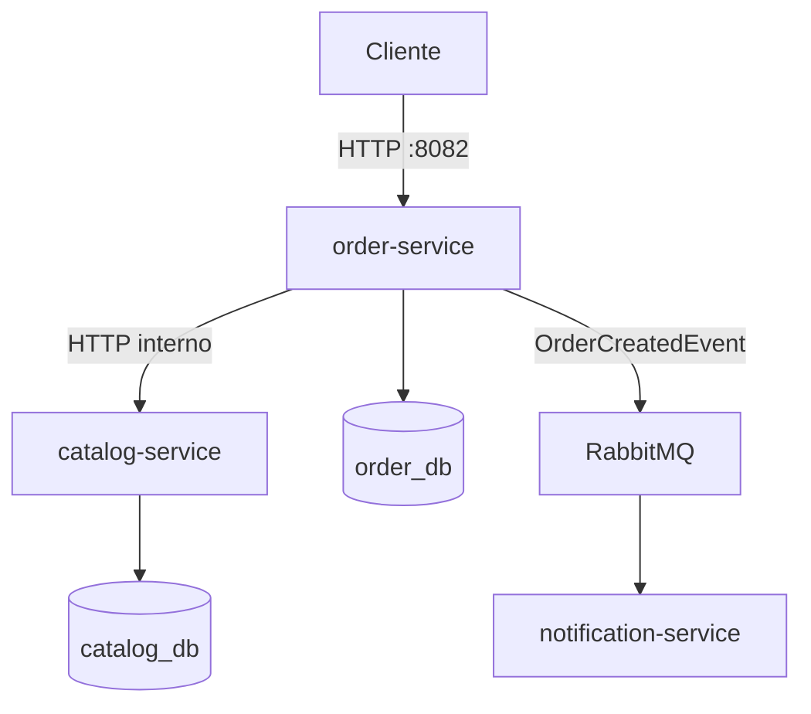

# Microservices Learning

Proyecto práctico para aprender los fundamentos de una arquitectura de microservicios con Java, Spring Boot, PostgreSQL, RabbitMQ y Docker Compose.

La aplicación representa una plataforma sencilla de catálogo y pedidos. Cada servicio tiene una responsabilidad concreta, se ejecuta de forma independiente y controla sus propios datos.

## Arquitectura



| Servicio | Responsabilidad | Puerto |
| --- | --- | ---: |
| `catalog-service` | Gestionar productos y disponibilidad | `8081` |
| `order-service` | Crear y consultar pedidos, validar productos y publicar eventos | `8082` |
| `notification-service` | Consumir `OrderCreatedEvent` y simular notificaciones mediante logs | `8083` |
| `catalog-db` | PostgreSQL exclusivo del catálogo | `5433` |
| `order-db` | PostgreSQL exclusivo de pedidos | `5434` |
| `rabbitmq` | Broker de mensajes y panel de administración | `5672` / `15672` |

## Tecnologías

- Java 21
- Spring Boot 4.1.1
- Spring Web MVC y RestClient
- Spring Data JPA
- PostgreSQL 16
- Flyway
- RabbitMQ y Spring AMQP
- Actuator
- Maven Wrapper
- Docker y Docker Compose

## Estructura

```text
microservices-learning/
├── catalog-service/
│   ├── Dockerfile
│   ├── pom.xml
│   └── src/
├── order-service/
│   ├── Dockerfile
│   ├── pom.xml
│   └── src/
├── notification-service/
│   ├── Dockerfile
│   ├── pom.xml
│   └── src/
├── compose.yaml
└── README.md
```

Cada servicio es una aplicación Spring Boot independiente con su propio `pom.xml`, configuración y ciclo de vida. No se utiliza un proyecto Maven multi-module.

## Requisitos

Para ejecutar la arquitectura completa solo se necesita:

- Docker Desktop con Docker Compose.
- Puertos `8081`, `8082`, `8083`, `5433`, `5434`, `5672` y `15672` disponibles.

Para ejecutar o modificar los servicios fuera de Docker también se necesita Java 21.

## Arranque rápido

Desde la raíz del proyecto:

```bash
docker compose up --build -d
```

Comprobar el estado:

```bash
docker compose ps
```

Los seis servicios deberían aparecer como `healthy`.

Consultar los logs:

```bash
docker compose logs -f
docker compose logs -f order-service
docker compose logs -f notification-service
```

## Uso de la API

### Crear un producto

```bash
curl -X POST http://localhost:8081/api/products \
  -H "Content-Type: application/json" \
  -d '{"name":"Teclado mecánico","price":79.90,"available":true}'
```

### Consultar productos

```bash
curl http://localhost:8081/api/products
curl http://localhost:8081/api/products/1
```

### Crear un pedido

Antes de crear un pedido debe existir un producto disponible con el identificador indicado.

```bash
curl -X POST http://localhost:8082/api/orders \
  -H "Content-Type: application/json" \
  -d '{"productId":1,"quantity":2}'
```

### Consultar pedidos

```bash
curl http://localhost:8082/api/orders
curl http://localhost:8082/api/orders/1
```

## Flujo de creación de un pedido

1. El cliente envía un `POST` a `order-service`.
2. `order-service` consulta el producto mediante HTTP a `catalog-service`.
3. Si el producto existe y está disponible, el pedido se guarda en `order_db`.
4. `order-service` publica un `OrderCreatedEvent` en RabbitMQ.
5. RabbitMQ enruta el evento a `notification.order-created.queue`.
6. `notification-service` consume el evento, registra la notificación y envía el `ACK`.

Ejemplo del evento:

```json
{
  "eventId": "5f619d5d-a27f-49e2-b65f-7bf9aaf235ad",
  "orderId": 1,
  "productId": 1,
  "quantity": 2,
  "createdAt": "2026-10-14T08:42:33.300797Z"
}
```

## Comunicación entre contenedores

Los contenedores se comunican mediante la red privada creada automáticamente por Compose. Dentro de esa red no se utiliza `localhost`; se utilizan los nombres de los servicios:

```text
order-service → http://catalog-service:8081
order-service → jdbc:postgresql://order-db:5432/order_db
catalog-service → jdbc:postgresql://catalog-db:5432/catalog_db
order-service y notification-service → rabbitmq:5672
```

Los perfiles `application-docker.properties` contienen las direcciones internas. Compose activa esos perfiles con `SPRING_PROFILES_ACTIVE=docker`.

## RabbitMQ

Panel de administración:

- URL: [http://localhost:15672](http://localhost:15672)
- Usuario: `app_user`
- Contraseña: `app_password`

Topología utilizada:

```text
Exchange: orders.exchange
Routing key: order.created
Queue: notification.order-created.queue
```

La cola es durable. Si `notification-service` está apagado, RabbitMQ conserva los mensajes y los entrega cuando el consumidor vuelve a estar disponible.

## Health checks

Actuator expone el estado de cada aplicación:

```text
http://localhost:8081/actuator/health
http://localhost:8082/actuator/health
http://localhost:8083/actuator/health
```

Compose también comprueba la disponibilidad de PostgreSQL y RabbitMQ. Los servicios dependientes esperan a que sus dependencias estén saludables antes de arrancar.

## Persistencia

Compose utiliza tres volúmenes nombrados:

```text
catalog-db-data
order-db-data
rabbitmq-data
```

Detener y recrear los contenedores no elimina los datos:

```bash
docker compose down
docker compose up -d
```

Para eliminar también todos los volúmenes y datos:

```bash
docker compose down -v
```

> Atención: `down -v` elimina de forma irreversible los datos del entorno Compose.

## Comandos útiles

```bash
# Construir e iniciar
docker compose up --build -d

# Ver el estado
docker compose ps

# Seguir logs
docker compose logs -f nombre-del-servicio

# Detener sin eliminar
docker compose stop

# Volver a iniciar
docker compose start

# Eliminar contenedores y red, conservando volúmenes
docker compose down
```

## Manejo de errores

`order-service` traduce los principales fallos del catálogo:

| Situación | Respuesta |
| --- | --- |
| Producto inexistente | `400 Bad Request` |
| Producto no disponible | `409 Conflict` |
| Catálogo inaccesible o timeout | `503 Service Unavailable` |

El cliente HTTP utiliza timeouts de conexión y lectura para evitar esperas indefinidas.

## Conceptos practicados

- Diferencias entre monolito, monolito modular y microservicios.
- División por responsabilidades y base de datos por servicio.
- Comunicación síncrona mediante HTTP.
- DTO externos y ausencia de entidades JPA compartidas.
- Timeouts, latencia y fallos de red.
- Comunicación asíncrona mediante eventos.
- Producer, consumer, exchange, routing key, queue y ACK.
- Consistencia eventual e idempotencia.
- Límites de `@Transactional` entre sistemas diferentes.
- Conceptos de Transactional Outbox, Saga y compensación.
- Dockerfiles multietapa, perfiles, redes, volúmenes y health checks.

## Alcance y mejoras futuras

El proyecto está limitado deliberadamente a fundamentos. No implementa:

- Reserva distribuida o reducción de stock.
- Transactional Outbox.
- Persistencia de eventos procesados para garantizar idempotencia.
- Saga completa.
- API Gateway, OAuth2, JWT o Keycloak.
- Tracing distribuido, Kubernetes o service mesh.

Estas capacidades serían los siguientes pasos naturales en un sistema destinado a producción.

## Seguridad

Las credenciales incluidas en `compose.yaml` son exclusivamente para desarrollo local. No deben reutilizarse en producción ni publicarse como secretos reales. En un entorno profesional se utilizarían variables protegidas o un gestor de secretos.
